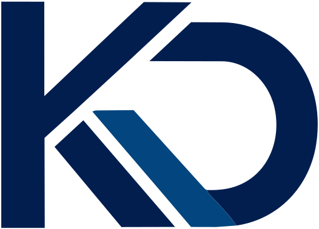
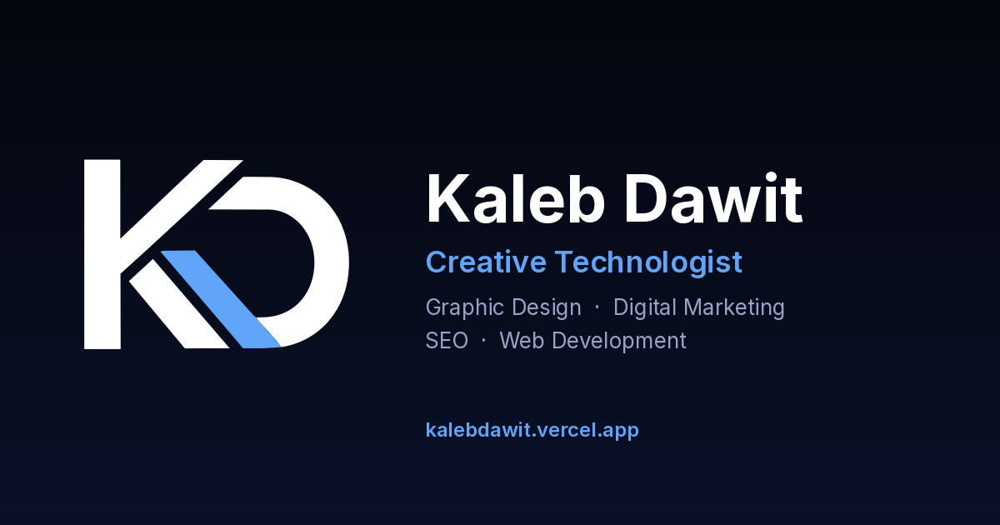

<div align="center">

<a href="https://kalebdawit.vercel.app/">
  <picture>
    <source media="(prefers-color-scheme: dark)" srcset="assets/logos/kd-logo-light.svg">
    
  </picture>
</a>

# Kaleb Dawit

### Design. Market. Build.

A fast, accessible, one-page portfolio for a graphic designer, digital marketer and developer based in Addis Ababa, Ethiopia.

<br>

[](https://kalebdawit.vercel.app/)


<br>

<a href="https://kalebdawit.vercel.app/">
  
</a>

</div>

---

## ✨ What's on the site

| | Section | What it does |
| :-: | --- | --- |
| 👋 | **Hero and About** | Bold intro, a typing text effect and animated stats |
| 💻 | **Development** | Merafe Stories, Tech Bytes and Medresha, with day/night previews that swap by themselves |
| 🎨 | **Graphic Design** | Logo and brand identity, posters and social graphics, each opening in a full-screen gallery |
| 📈 | **Digital Marketing** | SEO setup, the Eleroid Drinks website and a content strategy sample |
| 📄 | **Resume** | CV preview popup and a PDF download |
| ✉️ | **Contact** | The Email button copies my address and opens the mail app. Social links sit below it |
| 🌗 | **Day and night themes** | The whole site and the KD logo switch together |

## 🔗 Featured projects

| Project | What it is | Link |
| --- | --- | --- |
| **Merafe Stories** | Responsive e-book web app | [Visit](https://merafe-stories.netlify.app/) |
| **Tech Bytes** | Retro-themed tech news platform | [Visit](https://techbytes-news.netlify.app/) |
| **Medresha** | Android app for saving exact doors | [Visit](https://medresha.vercel.app/) |
| **Eleroid Drinks** | My first website, built with GoDaddy | [Visit](https://eleroiddrinks.godaddysites.com/) |

## 🧰 Built with

Plain **HTML, CSS and JavaScript**. There is no framework, no build step and no dependencies, so the whole site stays small, quick and easy to maintain. It is hosted on **Vercel**.

## 📊 Quality checks

Measured in October 2026.

| Check | Result |
| --- | :-: |
| ⚡ Google PageSpeed, desktop | **100** performance, **100** accessibility, **100** best practices, **100** SEO |
| 📱 Google PageSpeed, mobile | **93** performance, **100** accessibility, **100** best practices, **100** SEO |
| 🛡️ Security headers (Snyk) | **A+** |
| ♿ WAVE accessibility | **0** errors, **0** contrast errors |

**How it gets there**

- 🖼️ Images are WebP, about 1000px wide, and load lazily. Second images load shortly after the page is ready.
- 🔒 Strict Content-Security-Policy and other security headers, set in `vercel.json`.
- 🔎 `sitemap.xml`, `robots.txt`, a canonical link, Open Graph and Twitter cards, and structured data (schema.org Person and WebSite).
- ↪️ Old pages (`/portfolio.html`, `/resume.html`, `/blog.html`) redirect to the matching part of this page.

## 🗂️ Project structure

<details>
<summary>Click to open</summary>

```
kaleb-dawit-website/
├── index.html          the whole page
├── style.css           all styles (day and night themes)
├── script.js           all behavior (galleries, swaps, theme, CV popup)
├── vercel.json         redirects and security headers
├── sitemap.xml         one page
├── robots.txt
├── googlebbd6c3949a1c3b41.html   Google Search Console verification
└── assets/
    ├── files/          CV (PDF)
    ├── images/         project images (WebP)
    └── logos/          KD logo, favicons, share image (og-image.png)
```

</details>

## 🚀 Run it locally

Open `index.html` in a browser, or use a simple local server such as the VS Code **Live Server** extension.

> The security headers only apply on Vercel, so they are not active locally.

## 🖼️ Update the content

<details>
<summary>Click to open</summary>

- **Swap an image:** replace the file in `assets/images/` and keep the same name. No code change is needed.
- **Add a design to a gallery:** put the WebP file in `assets/images/`, then add one `` line to the hidden list at the bottom of `index.html` (`#group-data`). The card and the full-screen gallery both read from that list, so they stay in sync.
- **Image tips:** use WebP, about 1000px wide, and keep each file under roughly 300 KB.
- **File names:** lowercase letters and hyphens, with no spaces (for example `social-theatre.webp`).
- **Code rule:** the Content-Security-Policy blocks inline code, so keep JavaScript in `script.js` and styles in `style.css`.

</details>

## ☁️ Deploy

Pushing to the `master` branch deploys the site automatically on Vercel.

Vercel project settings: **Framework Preset:** Other, **Output Directory:** `.`

## 🤝 Connect

<div align="center">

[](https://kalebdawit.vercel.app/)
[](https://www.linkedin.com/in/kaleb-dawit-678b26278/)
[](https://github.com/kaleb2343)
[](https://x.com/Kaleb2343)
[](https://t.me/kaleb_dawit)

</div>

---

<div align="center">

© 2026 Kaleb Dawit. All rights reserved.<br>
The designs, images and written content on this site are my own work. Please don't copy or reuse them without asking me first.

</div>